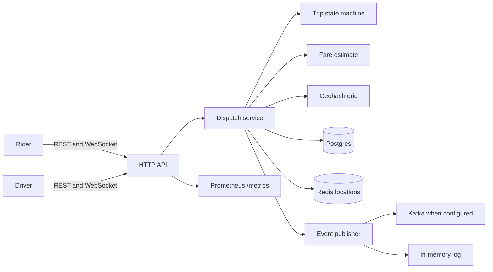

# go-ride-dispatch

A small ride-hailing dispatch service written as a public portfolio project by Arpan Bom ([applycoding](https://github.com/applycoding)). It accepts rider and driver traffic over HTTP and WebSocket, keeps live driver positions, matches a pickup to the nearest fresh driver with a geohash grid, and walks the trip through a fixed state machine.

This is a demo of service shape, not a production dispatch platform. There is no authentication, no payments, no road routing, and no multi-city supply pool. Fares are a straight-line estimate scaled by a fixed road factor. The spatial index lives in the API process. Kafka publishing is optional and at-most-once.

## Features

- REST API for riders, drivers, location ingest, fare estimates, and trip transitions
- WebSocket fan-out of trip events to the rider and the assigned driver
- Geohash grid index plus haversine ranking for nearest-driver matching
- Trip state machine: `requested → matched → accepted → arrived → in_progress → completed`, with `cancelled` from any non-terminal state
- Fare quote in integer cents (base + distance + duration, then surge)
- Postgres via `pgx` for riders, drivers, and trips, with an in-memory repository when `DATABASE_URL` is unset
- Redis for the latest driver location, with an in-memory stand-in when `REDIS_ADDR` is unset
- `Publisher` interface with an in-memory implementation and a Kafka writer (`segmentio/kafka-go`)
- Structured JSON logs (`slog`), Prometheus metrics, env configuration, and graceful shutdown
- Table-driven tests and benchmarks for matching; `docker compose`, Dockerfile, Makefile, golangci-lint, GitHub Actions

## Architecture



Matching does not scan every driver. The pickup is encoded as a geohash, a ring of neighboring cells is expanded until it covers the search radius, and only drivers in those cells are ranked by haversine distance. Stale locations and drivers who are not `available` are skipped. The chosen driver is reserved with a compare-and-swap so two trips cannot claim the same driver.

On startup the process rebuilds the in-memory index from Redis (or the in-memory location store). Postgres is the system of record for trip status. The default demo path uses neither: leave `DATABASE_URL`, `REDIS_ADDR`, and `KAFKA_BROKERS` empty.

## Run

Requires Go 1.22 or newer.

```bash
make test
make run
```

`make run` listens on `:8080` and logs that Postgres and Redis are not configured. That is the intended laptop demo.

Postgres and Redis:

```bash
docker compose up --build
```

The compose file starts Postgres 16, Redis 7, and the service. It does not start a Kafka broker. To publish to Kafka, set `KAFKA_BROKERS` (comma-separated) and `KAFKA_TOPIC` (default `dispatch.trips`). A failed publish is logged and counted; it does not roll the trip back.

### Configuration

| Variable | Default | Purpose |
| --- | --- | --- |
| `HTTP_ADDR` | `:8080` | Listen address |
| `DATABASE_URL` | empty | Postgres DSN; empty uses memory |
| `REDIS_ADDR` | empty | Redis address; empty uses memory |
| `REDIS_PASSWORD` | empty | Redis password |
| `REDIS_DB` | `0` | Redis database |
| `KAFKA_BROKERS` | empty | Comma-separated brokers; empty uses memory |
| `KAFKA_TOPIC` | `dispatch.trips` | Kafka topic |
| `LOG_LEVEL` | `info` | `debug`, `info`, `warn`, or `error` |
| `SHUTDOWN_TIMEOUT` | `10s` | Graceful shutdown budget |
| `GEOHASH_PRECISION` | `6` | Geohash length, 1–12 |
| `MATCH_RADIUS_METERS` | `5000` | Nearest-driver radius |
| `LOCATION_MAX_AGE` | `2m` | Oldest location that can be matched |
| `FARE_BASE_CENTS` | `250` | Base fare |
| `FARE_PER_KM_CENTS` | `150` | Per billed kilometre |
| `FARE_PER_MIN_CENTS` | `30` | Per estimated minute |
| `FARE_CURRENCY` | `USD` | 3-letter currency code |
| `FARE_SPEED_KMH` | `30` | Speed used to estimate duration |
| `ROAD_FACTOR` | `1.3` | Multiplier on straight-line distance |

Billed distance is haversine distance times `ROAD_FACTOR`. Duration is that distance at `FARE_SPEED_KMH`. Surge must be between 1 and 4; an omitted surge is 1. The fare is fixed when the trip is requested.

`GET /healthz` is process liveness. `GET /readyz` pings Postgres and Redis when those backends are configured.

## API

Examples assume `jq`. Create a rider and a driver, publish a location, then request a trip.

```bash
BASE=http://localhost:8080

RIDER=$(curl -s -X POST "$BASE/v1/riders" \
  -H 'content-type: application/json' \
  -d '{"name":"Ava"}' | jq -r .id)

DRIVER=$(curl -s -X POST "$BASE/v1/drivers" \
  -H 'content-type: application/json' \
  -d '{"name":"Sam"}' | jq -r .id)

curl -s -X POST "$BASE/v1/drivers/$DRIVER/location" \
  -H 'content-type: application/json' \
  -d '{"lat":37.7749,"lng":-122.4194}'

curl -s -X POST "$BASE/v1/estimates" \
  -H 'content-type: application/json' \
  -d '{"pickup":{"lat":37.7749,"lng":-122.4194},"dropoff":{"lat":37.7849,"lng":-122.4094}}'

TRIP=$(curl -s -X POST "$BASE/v1/trips" \
  -H 'content-type: application/json' \
  -d "{\"rider_id\":\"$RIDER\",\"pickup\":{\"lat\":37.7749,\"lng\":-122.4194},\"dropoff\":{\"lat\":37.7849,\"lng\":-122.4094}}" )
echo "$TRIP" | jq .
```

A driver who is online and inside the radius is matched immediately and the response status is `matched`. With no driver nearby the trip stays `requested`; `POST /v1/trips/{id}/match` tries again.

```bash
ID=$(echo "$TRIP" | jq -r .id)
for step in accept arrive start complete; do
  curl -s -X POST "$BASE/v1/trips/$ID/$step" \
    -H 'content-type: application/json' \
    -d "{\"driver_id\":\"$DRIVER\"}" | jq .status
done
```

Cancel with the rider id or the assigned driver id:

```bash
curl -s -X POST "$BASE/v1/trips/$ID/cancel" \
  -H 'content-type: application/json' \
  -d "{\"actor_id\":\"$RIDER\"}"
```

WebSocket clients subscribe with `GET /v1/ws?role=rider|driver&actor_id=...`. The first frame is `{"type":"hello",...}`. Later frames are `{"type":"trip.matched","trip":{...}}` and the other transition names (`trip.requested`, `trip.accepted`, `trip.arrived`, `trip.started`, `trip.completed`, `trip.cancelled`). Origin checks are off because the demo has no auth.

| Method | Path | Body |
| --- | --- | --- |
| `POST` | `/v1/riders` | `{"name":"Ava"}` |
| `GET` | `/v1/riders/{id}` | |
| `POST` | `/v1/drivers` | `{"name":"Sam"}` |
| `GET` | `/v1/drivers/{id}` | |
| `POST` | `/v1/drivers/{id}/status` | `{"status":"offline"}` or `"available"` |
| `POST` | `/v1/drivers/{id}/location` | `{"lat":37.77,"lng":-122.42}` |
| `POST` | `/v1/estimates` | pickup, dropoff, optional surge |
| `POST` | `/v1/trips` | rider_id, pickup, dropoff, optional surge |
| `GET` | `/v1/trips/{id}` | |
| `POST` | `/v1/trips/{id}/match` | |
| `POST` | `/v1/trips/{id}/accept` | `{"driver_id":"..."}` |
| `POST` | `/v1/trips/{id}/arrive` | `{"driver_id":"..."}` |
| `POST` | `/v1/trips/{id}/start` | `{"driver_id":"..."}` |
| `POST` | `/v1/trips/{id}/complete` | `{"driver_id":"..."}` |
| `POST` | `/v1/trips/{id}/cancel` | `{"actor_id":"..."}` |
| `GET` | `/v1/ws` | query `role`, `actor_id` |
| `GET` | `/healthz`, `/readyz`, `/metrics` | |

The first location report moves an `offline` driver to `available`. A driver on a trip stays `busy` until the trip completes or is cancelled, then returns to the index if the last location is still fresh.

## Tests and benchmarks

```bash
make test          # unit tests, no Postgres or Redis
make race          # go test -race ./...
make bench         # matching benchmarks
make lint          # golangci-lint
make integration   # Postgres and Redis; requires DATABASE_URL and REDIS_ADDR
```

Matching tests include a brute-force check: the index's top drivers must equal a full scan of the same points. Benchmarks seed 10k and 50k drivers around San Francisco and query the nearest five within 3 km. One run on the dev VM this was written on:

```text
BenchmarkNearest/10000-4        1140    1021141 ns/op    314360 B/op    1913 allocs/op
BenchmarkNearest/50000-4         273    4420436 ns/op   1666053 B/op    1918 allocs/op
BenchmarkNearestParallel-4       788    1396865 ns/op   1666039 B/op    1918 allocs/op
```

Those numbers are a single machine, not a performance target. The parallel case is the 50k index.

GitHub Actions runs `go test -race` and golangci-lint on every push and pull request. A second job runs the `integration` build tag against Postgres 16 and Redis 7.

## Layout

```text
cmd/dispatch            process wiring, signals, shutdown
internal/api            HTTP routes and WebSocket hub
internal/service        use cases
internal/matching       geohash grid
internal/geo            encode, neighbors, haversine
internal/trip           state machine
internal/fare           tariff
internal/store          memory and Postgres repositories
internal/location       memory and Redis location stores
internal/events         publisher interface, memory log, Kafka writer
internal/metrics        Prometheus collectors
internal/config         environment
```

## What a production system would still need

Authentication and per-actor authorization, a routing engine instead of haversine times a constant, offer timeouts and explicit driver decline, a transactional outbox for Kafka, and a spatial index that more than one API instance can share. Those are left out on purpose so the demo stays small enough to read.

## License

[MIT](LICENSE). Copyright 2026 Arpan Bom.
